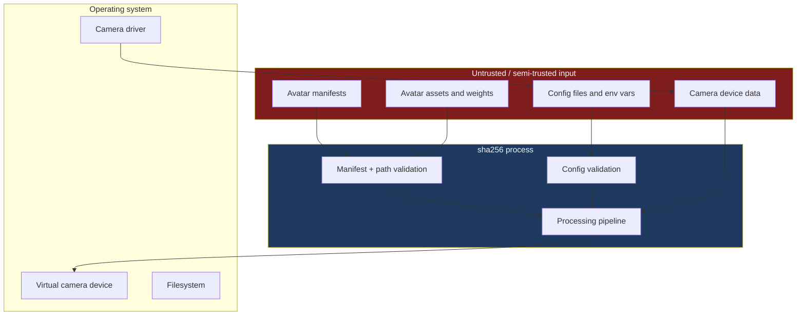

# sha256 — Security

**Status:** foundation. The mitigations marked *implemented* exist and are
tested. Everything else is design intent for components that do not exist yet.

sha256 is a local desktop application with no server, no accounts, and no
network access. That removes whole categories of risk — and concentrates what
remains in a few specific places.

---

## 1. What is being protected

| Asset | Why it matters | Exposure if compromised |
|---|---|---|
| **Webcam frames** | Live video of the user and their surroundings | Severe — the highest-value asset here |
| **Facial data** | Landmarks, pose, expressions derived from the user | Biometric-adjacent |
| **Avatar assets** | Owner's work; possibly licensed material | Loss of value; possible license violation |
| **Model weights** | Large, sometimes restrictively licensed | Redistribution liability |
| **Virtual camera output** | What meeting participants see | Impersonation if hijacked |
| **Configuration** | Local paths and settings | Low; contains no credentials by design |

There are deliberately **no credentials to protect**: no API keys, no tokens, no
accounts. The `.env.example` file has no secret-shaped variables in it, and that
is intentional rather than incidental.

---

## 2. Trust boundaries

The boundary that matters most is **avatar manifests**. They are hand-edited
today, but the design anticipates downloadable avatar packs — at which point a
manifest becomes genuinely untrusted input. It is validated as such now, before
that is true, because retrofitting validation after a format is in the wild is
considerably harder.

---

## 3. Threat model

### T1 — Malicious avatar pack reads or writes files outside its directory
**Likelihood:** low today, realistic once packs are distributable
**Impact:** high — arbitrary file read, or overwrite

**Mitigations (implemented):**
- Asset and preview paths are validated at parse time. Absolute paths, drive
  letters (`C:`), and `..` traversal are rejected.
- Validation inspects the **raw string**, not `pathlib` — because `pathlib`
  resolves differently on Windows and POSIX, and a pack authored on one must be
  judged identically on the other.
- Avatar ids are constrained to `^[a-z0-9][a-z0-9_-]{2,63}$`. The id is used as
  a directory name, so this closes traversal via the id itself.
- The manifest `id` must equal its directory name.
- Tested as a security property in `tests/unit/test_avatar_manifest.py`, with
  explicit traversal payloads.

### T2 — Malicious or corrupted model weights
**Likelihood:** low today (no weights are loaded); realistic later
**Impact:** high — model deserialisation is a known code-execution vector

**Mitigations:**
- *Implemented:* optional SHA-256 verification of declared assets; size
  mismatch detection; zero-byte rejection.
- *Design intent:* prefer **ONNX** over pickle-based formats. PyTorch `.pt`
  files are pickles and executing one is equivalent to running arbitrary code.
  If a `.pt` file must ever be loaded, `weights_only=True` is mandatory.
- *Design intent:* checksums become **required**, not optional, for any avatar
  acquired over the network.

### T3 — Configuration used to execute arbitrary code
**Likelihood:** low
**Impact:** high

**Mitigations (implemented):**
- Backends are named by **registry id**, never by import path. A config file
  cannot name a Python module to import. This is the specific reason the
  registry exists rather than a simpler dotted-path lookup.
- Unknown configuration keys are rejected (`extra="forbid"`).
- TOML via `tomllib` — a data format with no code-execution semantics, unlike
  `yaml.load`.

### T4 — Virtual camera hijacking or impersonation
**Likelihood:** low
**Impact:** high — another application could present video as the user

**Notes:** this is largely the operating system's responsibility. The relevant
project decision is that a native Media Foundation virtual camera is preferred
over routing through a third-party application, partly because it keeps the
device's ownership and lifetime under sha256's control. See
`docs/decisions/ADR-0005-virtual-camera-strategy.md`.

### T5 — Sensitive data leaking into logs or crash reports
**Likelihood:** medium — this is an easy mistake to make
**Impact:** high

**Mitigations (implemented):**
- No crash reporting and no network log handlers exist.
- The real-time loop does not log per frame — for performance, and because a
  per-frame log would be a record of the user's facial movements on disk.
- Logs rotate (5 MB, 3 backups); unbounded logs are a privacy risk as well as a
  disk one.
- **Discipline required:** never log frame contents, landmark arrays, or
  expression values. This is a review rule, not something the code enforces.

### T6 — Supply-chain compromise via dependencies
**Likelihood:** low, but industry-wide and rising
**Impact:** critical — a compromised dependency runs with full process rights,
including camera access

**Mitigations (implemented):**
- Runtime dependencies are deliberately minimal: PySide6, pydantic,
  pydantic-settings, numpy, platformdirs. A short list keeps "we send nothing"
  auditable.
- All heavy AI components are **optional extras**, not installed by default.
- `uv.lock` pins the full transitive tree with hashes; CI installs `--frozen`.
- No plugin auto-discovery via entry points — loading arbitrary installed
  packages would be a supply-chain hazard that buys nothing while every backend
  ships in-tree.

### T7 — Secrets committed to the repository
**Likelihood:** low (there are no secrets), but permanent if it happens
**Impact:** high

**Mitigations (implemented):**
- `.gitignore` excludes `.env`, `*.pem`, `*.key`, `credentials.json`,
  `configs/local.*`.
- `detect-private-key` pre-commit hook.
- `gitleaks` scans full history in CI.
- No credential-shaped variables exist in `.env.example`, so there is no
  template inviting someone to fill one in and commit it.

### T8 — Unauthorised modification of the avatar library
**Likelihood:** low
**Impact:** medium — a swapped avatar is an impersonation vector

**Mitigations (implemented):**
- The `AvatarRepository` protocol is **read-only** — no `add`, `update`, or
  `delete`. A normal running application has no code path that can mutate the
  library. This is a stronger guarantee than a permission check on a mutating
  method, because there is no method to check.
- Library mutation is gated behind `developer_mode` (default `false`).

### T9 — Resource exhaustion
**Likelihood:** medium
**Impact:** medium — GPU OOM can destabilise the driver and the desktop

**Mitigations (implemented):**
- The residency cache **refuses** a load that cannot fit rather than attempting
  it. An out-of-memory failure part-way through can leave the driver in a bad
  state; a refusal is recoverable and explainable.
- `max_resident` bounds how many avatars can be loaded at once.
- Manifest dimensions are bounded (`output_width`/`output_height` ≤ 4096) so a
  manifest cannot request a 100000×100000 buffer.
- *Design intent:* the pipeline drops frames rather than queueing them, so
  overload becomes degraded frame rate instead of unbounded memory growth.

---

## 4. Security posture summary

**What sha256 does not do** — each of these removes a class of risk:

- No network access
- No telemetry, analytics, or crash reporting
- No account system, no credentials, no tokens
- No auto-update
- No elevated privileges
- No registry writes
- No code execution from configuration
- No plugin auto-loading
- No writes outside its own directories

**What it does do:**

- Validates every manifest against a strict schema before use
- Rejects path traversal at the parse boundary
- Verifies asset integrity when asked
- Refuses rather than attempts loads it cannot satisfy
- Isolates failures to the individual avatar
- Keeps the dependency surface small enough to audit

---

## 5. Development practices

| Practice | Enforcement |
|---|---|
| No secrets in Git | `.gitignore`, `detect-private-key`, gitleaks in CI |
| No model weights in Git | `.gitignore`, `check-added-large-files` (2 MB cap) |
| Pinned dependencies | `uv.lock`, CI installs `--frozen` |
| Strict typing | `mypy --strict` in CI |
| Linting | `ruff` in CI and pre-commit |
| Validate at boundaries | Pydantic with `extra="forbid"` on all external input |
| Document decisions | `docs/decisions/` |

---

## 6. Known gaps

Stated rather than implied:

- **No code signing.** A distributed binary should be signed; nothing is
  distributed yet.
- **No sandboxing.** Model inference runs in the main process. Isolating it
  would be a meaningful hardening step if untrusted avatar packs ever become
  real.
- **No manifest signing.** Checksums prove integrity, not provenance. A
  distributable pack format should be signed.
- **No formal dependency audit.** `pip-audit` or similar is not yet in CI.
- **Path validation is not fuzzed.** It is unit-tested against known payloads.
- **Threat model is unreviewed.** It reflects one engineer's analysis.

---

## 7. Reporting a vulnerability

This is a pre-alpha project with no users and no release. If you find a security
issue, open an issue at
the project's issue tracker — or, for anything you consider genuinely
sensitive, contact the maintainer privately rather than filing publicly.

A formal disclosure process should be established before any public release.

---

## See also

- `docs/PRIVACY.md` — what is processed and what never leaves the machine
- `docs/architecture/AVATAR_SYSTEM.md` — validation and residency in detail
- `docs/decisions/` — decision records, including the licensing constraints
