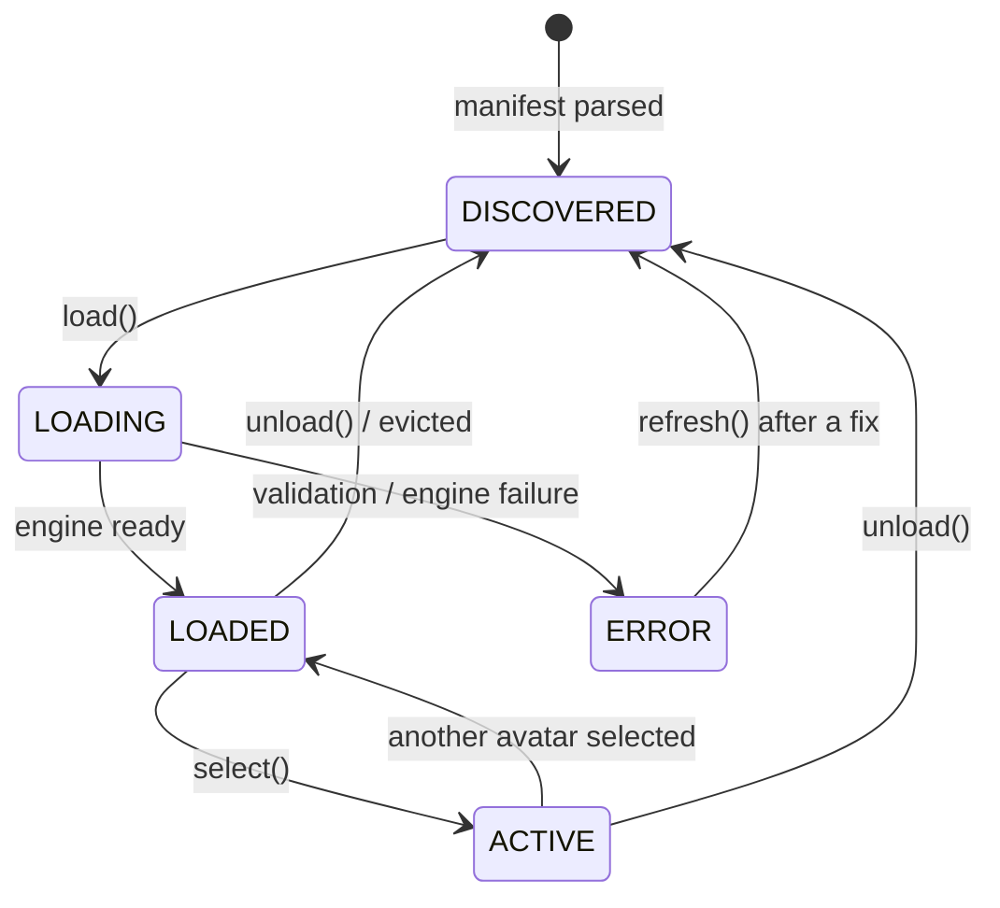

# SHA-256 — Avatar System

**Status:** the representation, storage, discovery, validation, residency, and
selection machinery is implemented and tested. What is *not* implemented is any
engine that loads real weights — so the design below is exercised end-to-end,
but only against placeholder avatars.

The governing requirement: **SHA-256 must not be architected around a single
avatar.** Adding an avatar must never require touching core application code.

---

## 1. How an avatar is represented

An avatar is a **directory containing a manifest**. The manifest is the only
thing the core application understands; everything else in the directory is
opaque payload handed to whichever engine the manifest names.

```
avatars/avatar_001/
  metadata.json     ← the manifest. The only required file.
  preview.png       ← gallery thumbnail (optional)
  model/            ← weights / engine artifacts. NOT in Git.
  config/           ← optional engine-specific extras
```

Schema: `src/sha256/core/avatar.py`.

```json
{
  "manifest_version": 1,
  "id": "avatar_001",
  "name": "Placeholder One",
  "version": "1.0.0",
  "description": "...",
  "tags": ["sample"],
  "preview": "preview.png",
  "assets": [
    { "path": "model/motion.onnx", "role": "weights",
      "sha256": "…64 hex chars…", "size_bytes": 148000000 }
  ],
  "engine": {
    "engine_id": "liveportrait_onnx",
    "min_engine_version": "0.2.0",
    "estimated_vram_mb": 1800,
    "device_preference": "cuda"
  },
  "rendering": {
    "output_width": 512, "output_height": 512,
    "expression_scale": 1.0, "head_motion_scale": 1.0
  },
  "engine_options": { "…engine-specific, passed through opaquely…" },
  "fictional": true
}
```

### The two fields that carry the architecture

**`engine.engine_id`** names a *registry id*, not an import path. The core never
imports an engine module to read a manifest, and an avatar built for an engine
this build does not have produces a clear "unsupported" message instead of an
import error.

**`engine_options`** is an opaque dict the core never interprets. A new engine
can accept entirely new options without any schema change here. This is what
prevents the manifest schema from accumulating a field per engine.

### Why Pydantic here and dataclasses elsewhere

Manifests cross an I/O boundary and are semi-trusted — hand-edited today,
potentially downloadable later. They should fail loudly and legibly. Per-frame
types (`VideoFrame`, `FaceTrackingResult`) are constructed thirty times a second
and use plain dataclasses, where validation cost would be real.

`extra="forbid"` is set deliberately: a typo like `renderring` is an error at
load time, not a silently ignored field leaving the avatar misconfigured in a
way that only shows up as odd-looking output.

---

## 2. Where avatar data is stored

| Location | Contents | In Git |
|---|---|---|
| `avatars/<id>/metadata.json` | Manifest | **Yes** — small, reviewable, defines the layout |
| `avatars/<id>/preview.png` | Thumbnail | No — owner-supplied image data |
| `avatars/<id>/model/` | Weights | No — large, and redistribution terms vary per model |
| `models/` | Shared artifacts (converted engines, common weights) | No |

In development, `avatars/` sits in the checkout. In an installed build it moves
under `%LOCALAPPDATA%`, because Program Files is read-only. `AppPaths` resolves
this once at startup (`src/sha256/config/paths.py`); nothing else hard-codes a
path.

### Why directory-per-avatar rather than a central index

| | Directory-per-avatar | Central `library.json` |
|---|---|---|
| Add an avatar | Copy a directory | Edit a shared file |
| Two avatars added independently | No conflict | Merge conflict |
| One corrupt manifest | That avatar is skipped | Whole library may fail to parse |
| Delete an avatar | Remove the directory | Remove files *and* the index entry, or leave a dangling one |
| Discovery cost | One directory scan | One file read |

The central index wins only on discovery cost, and only marginally: discovery
reads manifests, never weights, so a library of dozens costs a few milliseconds.
Every other column favours the directory layout, and they are all failure modes
that occur in normal use.

---

## 3. How avatars are discovered

`FilesystemAvatarRepository.discover()` scans the library root, reads each
`metadata.json`, validates it against the schema, and returns descriptors.

Rules that make this robust:

- **Failures are collected, never raised.** A malformed manifest is recorded in
  `errors()` and skipped. One bad avatar cannot hide a healthy library — tested
  explicitly in `tests/unit/test_avatar_repository.py`.
- **The manifest `id` must equal the directory name.** Otherwise one avatar has
  two plausible identities, and anything keyed by id (caches, exports, metric
  labels) becomes ambiguous.
- **Hidden and `_`-prefixed directories are skipped**, so `.git` and scratch
  directories are not mistaken for avatars.
- **Results are cached.** Discovery is called often — gallery, manager,
  diagnostics — and re-reading every manifest each time would be wasteful.
  `discover(force=True)` re-scans, which is what picks up an avatar added while
  the application is running. `AvatarManager.refresh()` always forces.

A descriptor holds the manifest plus an absolute root path. It carries no
weights and is cheap to build for every avatar in the library, which is what
keeps startup fast as the library grows.

---

## 4. Validation

Three levels, escalating in cost (`src/sha256/avatar/validation.py`):

| Level | Checks | Cost | When |
|---|---|---|---|
| **Manifest** | Schema-valid | Negligible | Always, at parse time |
| **Presence** | Non-optional assets exist and are non-empty | One `stat` per asset | Before every load |
| **Integrity** | Declared SHA-256 digests match | Reads every byte | Opt-in; always on import |

Errors block loading; warnings do not. A missing preview is a warning — the
avatar works, it just shows a generic tile. A missing weights file is an error.

An asset declaring `size_bytes` is checked against the file size even when
hashing is off: a truncated download is the most common corruption and detecting
it costs one `stat` call.

The digest is what will make downloadable avatar packs safe: an avatar whose
weights do not match its manifest is rejected rather than loaded.

### Path safety

Asset and preview paths are validated at parse time to be **relative and
contained**. Absolute paths, drive letters, and `..` traversal are rejected.

This is checked on the raw string rather than through `pathlib`, because
`pathlib` resolves differently on Windows and POSIX and an avatar pack authored
on one must be judged identically on the other. Once avatar packs are
distributable, this is the boundary that stops a manifest from referencing
arbitrary files on disk.

---

## 5. Loading and unloading



`AvatarManager.load()` performs, in order:

1. Resolve the descriptor — unknown id fails fast.
2. Already resident? Touch its LRU position and return.
3. Validate assets — blocking errors mark it `ERROR` and raise.
4. Ask the engine `supports(descriptor)` — an engine mismatch is refused, not
   silently downgraded. An avatar built for a neural engine must never fall back
   to the placeholder and look like a rendering bug.
5. Ask the residency cache to admit it — may require evictions, or refuse.
6. Evict what the cache nominated.
7. Load through the engine.
8. Record the footprint, replacing the manifest's estimate with the engine's
   measurement if one is available.

`unload()` releases engine resources, clears the cache entry, and clears the
active selection if it was active. It is safe to call on an avatar that is not
loaded.

**Loading is synchronous and thread-agnostic by design.** The manager creates no
threads; the caller decides where the work runs. State changes are announced via
`add_observer()`, so a UI can show a loading indicator regardless of which thread
performed the load. An observer that raises is logged and ignored — UI bugs must
not abort a load that already succeeded.

---

## 6. Selecting the active avatar

`select(avatar_id)` loads if needed, pins the avatar as active, and demotes the
previous one to `LOADED` — **resident, not unloaded**.

That is the point of the warm tier: switching back is instant, and if something
else needs the memory the residency cache will evict it. Unloading eagerly would
trade a rare memory saving for a guaranteed multi-second stall on every switch
back.

The pipeline asks `AvatarManager.active` for a descriptor. It never touches the
repository, the cache, or a file path — which is what keeps the processing loop
independent of how avatars are stored.

---

## 7. GPU memory management

The constraint on the reference machine: **16 GB VRAM** (verified via
`nvidia-smi` on the target RTX 5070 Ti), shared with the desktop compositor and
whatever video-call application is consuming the virtual camera. The default
budget is 6144 MiB, which leaves substantial headroom. That default is a
starting guess and is expected to change once real engines are profiled.

### Policy (`src/sha256/avatar/cache.py`)

- **The active avatar is pinned.** Evicting the avatar currently on camera is
  never the right answer.
- **Others are kept warm in LRU order.**
- **Admission requires fitting** both the count limit (`max_resident`, default
  2) and the VRAM budget. Otherwise LRU entries are evicted until it fits.
- **If it still does not fit, the load is refused.** An out-of-memory failure
  part-way through a load can leave the driver in a bad state; refusing is
  recoverable and can be explained to the user.
- **A budget of `0` means unbounded** — the honest reading of "nothing has been
  measured yet", not a budget of zero.

### Estimates versus measurements

The cache records whether a footprint came from the manifest (the author's
guess) or from the engine (`estimated_vram_mb()` after load). A policy driven by
a guess deserves less confidence than one driven by measurement, and conflating
them would hide that.

`NullAvatarEngine.estimated_vram_mb()` returns `None`, not `0` — it holds nothing
on the GPU, and `0` would read as a measurement rather than an absence.

### Deliberately not done yet

Real VRAM interrogation (`pynvml`, `torch.cuda.memory_allocated`) is not
implemented. It would need a dependency and would report numbers no engine
currently produces. The abstraction is in place (`performance/probes.py`); the
probe reports "not measured" rather than a fabricated value.

The eviction policy itself is implemented and unit-tested against simulated
pressure, but **it has never evicted a real model.** Treat it as designed and
verified-in-principle, not proven.

---

## 8. Versioning

Two independent version fields, and the distinction matters:

- **`manifest_version`** — the schema. This build supports `{1}`. An avatar
  declaring a newer version is reported as unsupported rather than parsed
  best-effort; silently ignoring fields it depends on would render it wrongly.
- **`version`** — the avatar's own content version, e.g. retrained weights. The
  application does not interpret it today; it exists so an update mechanism can
  compare without a schema change.

`engine.min_engine_version` lets an avatar declare the lowest engine version it
works with, so an avatar needing a newer engine is refused rather than rendered
incorrectly.

### Migration path

When `manifest_version: 2` arrives, the plan is to keep reading v1 by upgrading
it in memory at parse time, so existing avatars keep working. `SUPPORTED_MANIFEST_VERSIONS`
is a set precisely so it can hold several. No migration exists yet — there is
only one version.

---

## 9. Corrupted and missing assets

| Failure | Detected by | Result |
|---|---|---|
| Directory without `metadata.json` | Discovery | Skipped; reported in `errors()` |
| Malformed JSON | Discovery | Skipped; reported with the parse error |
| Schema violation | Discovery | Skipped; reported with the field path |
| `id` ≠ directory name | Discovery | Skipped; ambiguity refused |
| Duplicate id | Discovery | Second one skipped |
| Missing required asset | Validation | `ERROR`; load blocked |
| Missing optional asset | Validation | Warning; avatar still loads |
| Zero-byte asset | Validation | `ERROR` |
| Size mismatch | Validation | `ERROR` (truncated download) |
| Checksum mismatch | Validation (opt-in) | `ERROR` (corrupt or tampered) |
| Engine unavailable | `supports()` | `ERROR` with a clear reason |
| Exceeds VRAM budget | Residency cache | Refused before loading |

The consistent principle: **fail the individual avatar, never the library.** A
user with twelve avatars and one broken one should see eleven working avatars
and one clearly-marked error, not an application that will not start.

---

## 10. How this scales to many avatars

| Concern | How it is handled | Cost at 50 avatars |
|---|---|---|
| Discovery | Manifests only; weights untouched | One directory scan, ~50 small reads |
| Memory | Descriptors are metadata-only | Kilobytes |
| VRAM | Only `max_resident` avatars are loaded | Independent of library size |
| Gallery rendering | Previews are paths, loaded by the UI on demand | UI-side concern, not the manager's |
| Adding one | Copy a directory | No code change, no index edit |

Nothing in the design is linear in library size except the startup scan, and
that reads only small JSON files.

---

## 11. Supporting future avatar engines

Adding an engine requires:

1. Implement `AvatarEngine` (`core/interfaces.py`) in a new module.
2. Register it in `register_builtin_backends()` with its `requires` list.
3. Avatars opt in via `engine.engine_id` in their manifest.

No change to the manager, the repository, the cache, the pipeline, or the UI.

Multiple engines can coexist: each avatar names the one it needs, and
`supports()` is checked before loading. The manager holds one engine at a time
today (`attach_engine` replaces it and unloads everything, because avatars
resident in the old engine's memory are not resident in the new one). Supporting
several simultaneously would mean routing by `engine_id` in the manager — a
contained change, deliberately deferred until there is a second real engine to
justify it.

---

## 12. Owner-only avatar management

Adding and modifying avatars is an **owner/developer operation**, gated behind
`developer_mode` (default off, `docs/SECURITY.md`).

The `AvatarRepository` protocol is deliberately **read-only** — no `add`,
`update`, or `delete`. A normal running application therefore has no code path
that can mutate the library, which is a stronger guarantee than a permission
check on a mutating method.

Import tooling will be a separate, gated interface. When it is built it should:
compute and record checksums, validate before accepting, write atomically
(temp directory then rename, so an interrupted import leaves no half-avatar),
and refuse to overwrite an existing id without explicit confirmation.

None of that exists yet.

---

## 13. The future UI

Not implemented — the current shell has a combo box. The design supports:

| Feature | Backing |
|---|---|
| Gallery grid | `manager.statuses()` |
| Preview thumbnails | `descriptor.preview_path` |
| Selection | `manager.select(id)` |
| Loading state | `AvatarState.LOADING` via observers |
| Active indicator | `AvatarState.ACTIVE` |
| Error state | `AvatarStatus.error` |
| Resident/warm indicator | `AvatarStatus.vram_mb` |
| Developer management | `settings.developer_mode` |

Every state the UI needs to display already exists and is tested. The gallery is
presentation work, not architecture work — which was the goal.

---

## 14. Known gaps

Stated plainly:

- No engine loads real weights, so the load path has never moved a large file
  or allocated VRAM.
- Eviction is verified against simulated pressure only.
- No import/authoring tooling.
- No manifest migration (only one version exists).
- No avatar pack format, signing, or update mechanism — the checksum field
  anticipates it, nothing implements it.
- Previews are neither loaded nor cached by the application.
