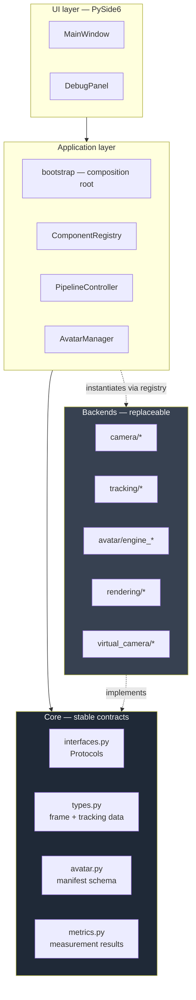
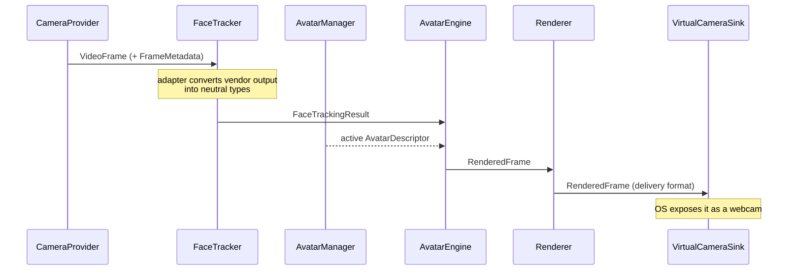
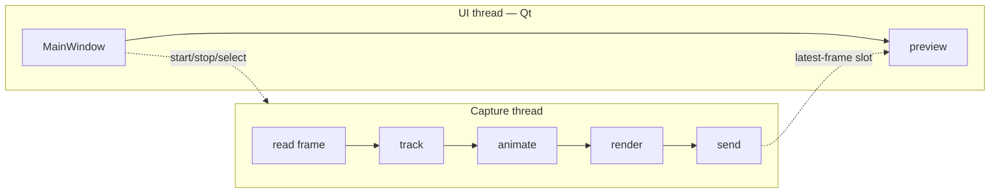

# SHA-256 — System Architecture

**Status:** foundation. The contracts described here exist and are tested; the
real-time components behind them do not exist yet.

This document describes the target architecture and the reasoning behind it. It
distinguishes throughout between what is **implemented**, what is **designed but
not built**, and what is **still undecided**.

---

## 1. The problem

SHA-256 must move a webcam frame through face tracking, avatar animation,
rendering, and out to a virtual camera, fast enough that a video call feels
live. That imposes three constraints that shape everything else:

1. **Latency is the product.** End-to-end delay above roughly 100 ms is
   perceptible as being out of sync with your own voice. Every architectural
   choice is measured against its cost per frame.
2. **The technology is unsettled.** The best open-source face tracker and the
   best portrait-animation model in 2026 are unlikely to be the best in 2027.
   Committing the application to either would mean rewriting it later.
3. **It runs on one machine.** No server absorbs the cost, and VRAM is finite
   and shared with the video-call application consuming the output.

The architecture is a direct response to these: a thin, stable core with
replaceable components behind it, and explicit resource accounting.

---

## 2. Layers



**The dependency rule:** arrows point inward. `core` imports nothing from the
layers above or beside it — only the standard library, `numpy`, and `pydantic`.
Backends depend on `core`; `core` never depends on a backend. This is what makes
"MediaPipe must be replaceable" true in practice rather than aspirational.

If a future change requires `core` to import a vendor library, that change is
wrong. Adapt at the boundary instead.

---

## 3. Data flow



Every hop carries the same `FrameMetadata`, containing the `frame_id` and the
monotonic `capture_timestamp` assigned at capture. That is not bookkeeping for
its own sake: it is the only way to measure true end-to-end latency rather than
summing per-stage averages, which hides queueing delay.

### The neutral types

| Type | Carries | Why it exists |
|---|---|---|
| `VideoFrame` | pixel buffer, format, metadata | Isolates capture; the pipeline never sees a vendor frame object |
| `LandmarkSet` | normalised `(N, 3)` points + `scheme` | A 68-point and a 478-point tracker differ only in `count` |
| `HeadPose` | pitch/yaw/roll + translation | One documented rotation convention prevents axis-flip bugs on tracker swap |
| `BlendshapeSet` | parallel names/weights + `scheme` | Expression data as a vector, readable per frame without dict overhead |
| `FaceTrackingResult` | all of the above + confidence | **The** tracking↔animation hand-off |
| `RenderedFrame` | pixels + provenance + render time | Adds the diagnostics an input frame has no notion of |

Two details that matter more than they look:

- **Landmarks are normalised** to `[0, 1]` at the adapter boundary, so nothing
  downstream needs to know the capture resolution.
- **`scheme` is mandatory** on `LandmarkSet` and `BlendshapeSet`. Two trackers
  with different topologies are not index-compatible, and a consumer that
  assumes a layout will produce silently wrong animation rather than an error.
  Naming the scheme makes the mismatch detectable.

---

## 4. Component contracts

All defined in `src/sha256/core/interfaces.py` as `typing.Protocol`.

| Protocol | Responsibility | Implemented |
|---|---|---|
| `CameraProvider` | Produce `VideoFrame`s | `null` only (synthetic) |
| `FaceTracker` | `VideoFrame` → `FaceTrackingResult` | `null` only (synthetic) |
| `AvatarEngine` | Drive a loaded avatar from tracking data | `null` only (schematic face) |
| `Renderer` | Composite into the delivery frame | `null` (CPU letterbox) |
| `VirtualCameraSink` | Publish to the OS | `null` (discards) |
| `PerformanceMonitor` | Collect timings and counters | **Real** |
| `AvatarRepository` | Enumerate the avatar library | **Real** (filesystem) |

### Why protocols rather than abstract base classes

A backend adapter does not need to import SHA-256 to satisfy a protocol —
structural typing is enough. Test doubles become trivial. And there is no
metaclass conflict when a backend already inherits from a vendor base class,
which several candidate libraries do.

### The `Component` lifecycle

`start()`/`stop()` are separate from `__init__` deliberately. Acquiring a camera
handle or a CUDA context during construction would make the object graph
impossible to build without hardware present — which would in turn make the
composition root untestable. Construction is cheap and always safe; `start()` is
where resources are taken.

Both must be idempotent. `stop()` must never raise, including on a component
that failed to start, because it runs on the error path.

---

## 5. Backend selection

Backends register a factory under a short id. Configuration names the id. The
composition root looks it up.

```
configs/default.toml          registry                  instance
  [tracking]                    "mediapipe" ─┐
  backend = "mediapipe"  ──►    "openseeface"├──►  MediaPipeFaceTracker()
                                "null"       ─┘
```

Three properties fall out of this:

- **Nothing imports a backend it does not use.** Registration stores a factory,
  so a registered MediaPipe backend does not import MediaPipe until selected.
  Startup stays fast and an uninstalled optional dependency is not an error.
- **Config contains no import paths.** A dotted path in a config file is
  executable input — a real hazard once avatar packs or plugins are
  downloadable.
- **Available ids can be listed**, so "unknown backend" is a helpful error and
  the UI can populate a dropdown from reality.

Swapping the tracker is a one-line config change plus one new adapter file. No
core code changes.

---

## 6. Threading — designed, not built

**Current state:** everything runs on the UI thread. `PipelineController` can
single-step one frame via `process_once()`. There is no loop.

**Target design:**



The decisions already made, and why:

- **One capture thread, not a stage-per-thread pipeline.** Handing a frame
  between threads costs a queue hop and a synchronisation point each way. At
  30 fps there is 33 ms per frame; if the stages fit, a single thread is both
  simpler and lower-latency. Parallelism gets introduced only if measurement
  shows a stage that genuinely overlaps.
- **Drop, never queue.** If a frame cannot be processed in time it is discarded
  and counted. An unbounded queue converts a throughput problem into an
  ever-growing latency problem — the failure mode where the avatar falls further
  behind the user the longer the call runs.
- **The UI never blocks on the pipeline.** The preview reads the most recent
  rendered frame; it does not pull from a queue and cannot apply back-pressure.
- **Avatar loading happens off both threads.** A neural engine load takes
  seconds. The call site in `MainWindow._on_avatar_changed` is marked with the
  `TODO(threading)` where this belongs.

Nothing above is validated. It is a starting hypothesis to be measured against
`docs/benchmarks/PERFORMANCE_PLAN.md`.

---

## 7. Error handling

Every error crossing a module boundary derives from `Sha256Error`
(`core/errors.py`). Backend adapters translate vendor exceptions — a MediaPipe
error, an ONNX Runtime failure, a Win32 `HRESULT` — into these at their own
edge. That translation is a load-bearing part of the decoupling: without it, a
vendor exception type leaks into UI code and the swap is no longer clean.

Degradation rules:

| Condition | Behaviour | Rationale |
|---|---|---|
| No face detected | Normal result with `face_detected=False` | Expected constantly; not an error |
| No avatar selected | Renderer emits a placeholder frame | Consumers handle a static frame far better than a stopped stream |
| Avatar fails validation | Marked `ERROR`, others unaffected | One bad avatar must not break the library |
| Load exceeds VRAM budget | Refused before attempting | A mid-load OOM can wedge the driver; refusal is recoverable |
| Component fails to start | Roll back started components, report | A half-started pipeline holds a camera handle and blocks retry |

---

## 8. Configuration

Layered, lowest priority first:

```
built-in defaults  →  configs/default.toml  →  configs/local.toml
                   →  environment / .env    →  explicit overrides
```

`local.toml` and `.env` are gitignored. Nested tables merge key-by-key, so
overriding one camera setting does not reset its siblings. Validation happens
once at startup and produces a readable message naming the offending field —
before any hardware is touched.

TOML rather than YAML: `tomllib` is in the standard library, and the format has
fewer ways to be subtly wrong by hand.

---

## 9. Repository layout

```
src/sha256/
  core/          contracts — the dependency floor
  app/           composition root + registry
  pipeline/      lifecycle control (loop not yet built)
  camera/  tracking/  rendering/  virtual_camera/     backends
  avatar/        library, residency, engines
  performance/   metric collection
  config/        schema, layered loader, path resolution
  ui/            PySide6 shell
  utils/         logging, timing
avatars/         the avatar library (one directory per avatar)
models/          shared model artifacts — never in Git
configs/         layered configuration
docs/            architecture, decisions, benchmarks, development
```

### Deviations from the originally proposed structure, and why

| Change | Reason |
|---|---|
| `src/sha256/` package instead of loose `src/app`, `src/camera`, … | Makes the project a real importable, installable package. Loose top-level directories collide with anything else on `sys.path`. |
| Added `core/` | The proposal had no home for shared contracts. Without one they would have landed in `utils/`, and the dependency rule would have been unenforceable. |
| Added `pipeline/` | Orchestration is neither a component nor the UI. Merging it into `app/` would have mixed wiring with runtime behaviour. |
| `avatars/` at the repo root, not `assets/avatars/` | The avatar library is user data with its own lifecycle and its own gitignore rules. `assets/` is for application chrome (icons, samples) that ships with the build. |
| `virtual_camera/` exposes a **Sink** | From SHA-256's side it consumes frames; it is only a "provider" from the OS's perspective. The name should match what the code does. |
| Metric result types in `core/metrics.py`, collection in `performance/` | The monitor protocol has to name its return type. Splitting contract from machinery keeps `core` importable without the implementation. |

---

## 10. What is deliberately absent

Listed so their absence reads as a decision rather than an oversight:

- **No dependency-injection framework.** The composition root is one readable
  function. A container would add indirection to a graph with ten nodes.
- **No plugin auto-discovery via entry points.** Registration is explicit in
  `register_builtin_backends`. Auto-loading arbitrary installed packages is a
  supply-chain risk that buys nothing while all backends ship in-tree.
- **No async/await.** The workload is CPU/GPU-bound, not I/O-bound. `asyncio`
  would add complexity without removing a single blocking call.
- **No abstraction over numpy.** Frames are numpy arrays throughout. Wrapping
  them would cost per-frame overhead to hide a dependency that is not going to
  be replaced.
- **No event bus.** Component relationships are direct and few. A bus would make
  the data flow harder to follow, not easier.

---

## 11. Open questions

Recorded rather than guessed at. Each blocks a decision that has not been made.

1. **Virtual camera approach.** The Windows options differ in licensing and
   deployment cost, and the choice constrains the project's own license. See
   `docs/decisions/ADR-0005-virtual-camera-strategy.md`.
2. **Whether tracking and animation can share one thread** at the target
   resolution and frame rate. Unmeasurable until real backends exist.
3. **GPU compositing.** The current renderer letterboxes on CPU. Whether a GPU
   path is needed depends on measured cost at the output resolution.
4. **Blendshape solving for landmark-only trackers.** OpenSeeFace emits 66
   landmarks and no blendshapes. Supporting it as a backup requires a solver
   stage that does not exist, and whose quality is unknown.
5. **Frame pacing.** Whether to emit at a fixed cadence or pass frames through
   as they complete. Fixed pacing is smoother; pass-through is lower latency.

---

## See also

- `docs/architecture/AVATAR_SYSTEM.md` — avatar representation and VRAM management
- `docs/OPEN_SOURCE_EVALUATION.md` — which backends to build, and why
- `docs/benchmarks/PERFORMANCE_PLAN.md` — how the above will be validated
- `docs/decisions/` — architecture decision records
